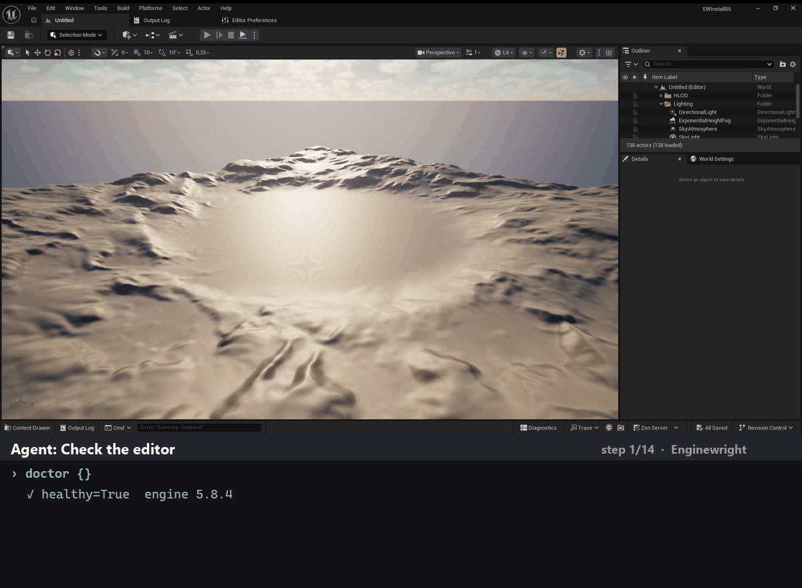
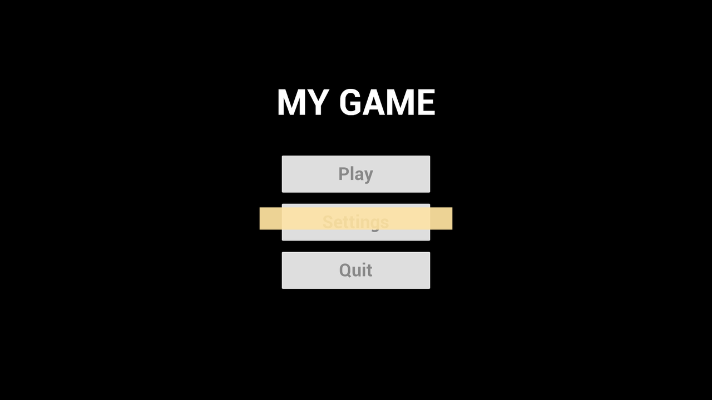
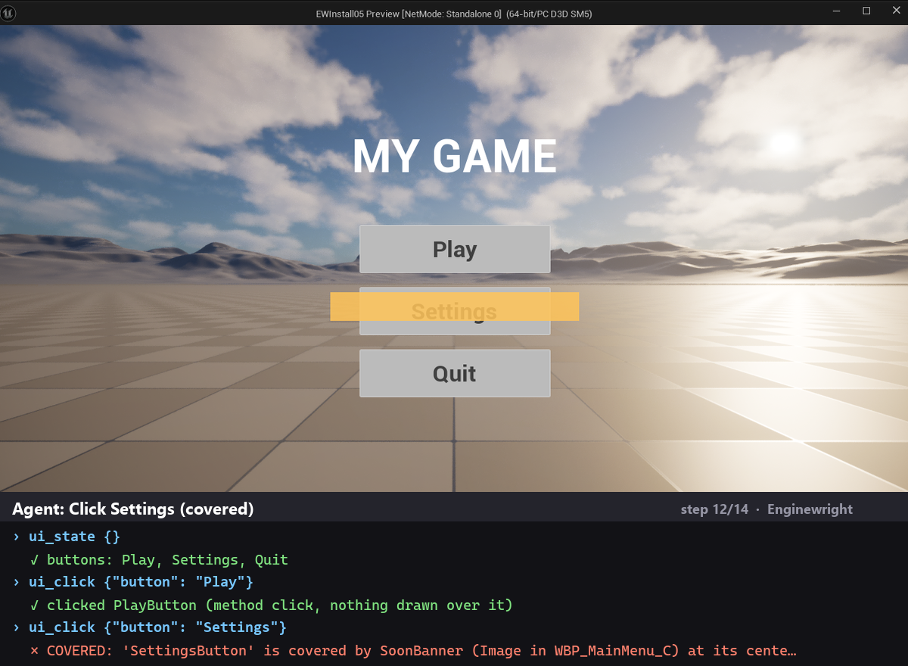
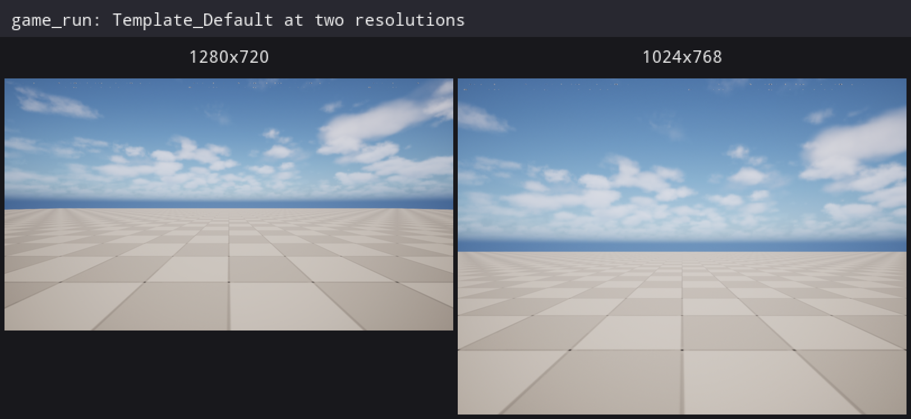
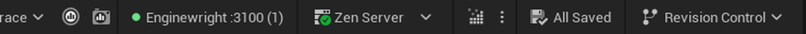
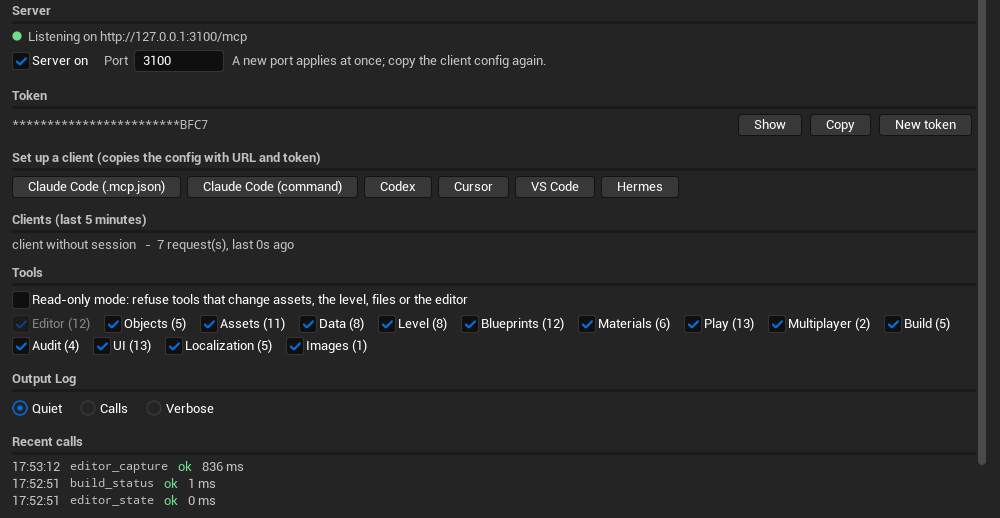

# Enginewright

[](docs/release-notes/v0.3.1.md)
[](#supported-versions)
[](#supported-versions)
[](LICENSE)

An Unreal Engine editor plugin that runs a [Model Context Protocol](https://modelcontextprotocol.io) (MCP) server inside the editor, so AI coding agents (Claude Code, Codex, Cursor, VS Code, Hermes or any MCP client) can read and edit your project, play it and check what is on screen. Every write is validated first and read back after.



*Above: an agent calls Enginewright tools on a fresh UE 5.8 project. It creates a menu widget and checks each change with `widget_render`, starts Play In Editor, opens the menu, reads the buttons with `ui_state`, clicks Play, and gets `COVERED` when it tries a button that another widget draws over.*

> **Early preview (v0.3).** One maintainer, APIs may change before 1.0. Use it on a project under version control and review what it changes. See the [v0.3.1 release notes](docs/release-notes/v0.3.1.md).

## Why

The focus is on edits you can trust:

- **Nothing extra to install.** One native C++ editor plugin. No Python, Node, proxy process or Epic's experimental MCP plugin.
- **Strict validation.** Unknown arguments, unknown properties or struct fields, wrong types and bad enum names are errors with a suggestion. They are never ignored.
- **All or nothing.** If one value in a call is bad, nothing is written. Each write is one undo step and is read back and compared.
- **Rollback.** `batch` runs several steps in one call; if a step fails, the earlier steps are undone.
- **Safe by default.** Asset edits are refused while Play In Editor runs. Deleting an asset that is still used is refused, and the reply lists who uses it. A click on a button that another widget covers is refused. The server listens on localhost only and needs a per-project token.

### Compared with Epic's MCP toolset in UE 5.8

UE 5.8 ships an experimental MCP toolset with a larger tool catalog than Enginewright. Enginewright makes a different trade-off. In our use of the 5.8 toolset, some writes reported success while a misspelled key was silently ignored, and some asset lookups gave misleading results during Play In Editor. Enginewright rejects those cases with an error. Epic's toolset exists only in 5.8; Enginewright does not depend on it.

## Screenshots

| | |
|---|---|
|  |  |
| **Fresh install.** The prebuilt zip in a blank UE 5.8 project; `doctor` reports a healthy editor. | **`widget_render`.** A Widget Blueprint as a PNG at any resolution, no Play In Editor needed. |
|  |  |
| **`ui_click` in Play In Editor.** The click is checked like a real one: a button under another widget is reported as `COVERED`. | **`game_run` + `image_compose`.** The game started with a map URL at two resolutions, its screenshots collected and put side by side. |

## Supported versions

| Unreal Engine | Platform | Status |
|---|---|---|
| 5.8 | Windows (Win64) | Tested (prebuilt zip and source) |
| Other versions, Mac, Linux | — | Not tested yet |

## Install (about 5 minutes)

These steps were run as written on a new, empty UE 5.8 project (no C++ code) with the v0.3.1 zip.

**Prebuilt zip (Blueprint or C++ projects, UE 5.8 Win64)**

1. Download `Enginewright-<version>-UE5.8-Win64.zip` from [Releases](https://github.com/shanyup/enginewright/releases). Optional: compare its SHA-256 with the one in the release notes (`Get-FileHash <zip>` in PowerShell).
2. Close the editor. Unzip into your project's `Plugins/` folder (create the folder if it does not exist), so you get `<YourProject>/Plugins/Enginewright/Enginewright.uplugin`.
3. Open the project. The plugin is enabled by default; nothing is compiled. The Output Log prints
   `Enginewright: MCP server on http://127.0.0.1:3100/mcp (… tools). Client configs: <YourProject>/Saved/Enginewright/clients`.
4. Connect your client. Ready-to-paste configs (URL + token) are in `<YourProject>/Saved/Enginewright/clients/`:

   | Client | File | What to do |
   |---|---|---|
   | Claude Code | `claude-code.txt` | Run the command once in your project folder (or merge `claude-code.mcp.json` into `.mcp.json`). |
   | Codex | `codex.toml` | Append to `~/.codex/config.toml`. |
   | Cursor | `cursor.mcp.json` | Merge into `.cursor/mcp.json`. |
   | VS Code | `vscode.mcp.json` | Merge into `.vscode/mcp.json`. |
   | Hermes | `hermes.yaml` | Merge under `mcp_servers` in your Hermes `config.yaml`. |

   The files hold your project's token: do not commit them (`Saved/` is normally ignored). An agent that is already connected can print them with the `client_config` tool.
5. Ask your agent to call `doctor`. It reports the engine version, the server, the open level and any problems, each with its fix. On a new project it usually warns that the editor slows down in the background (an Unreal default that makes Play In Editor tests slow); ask the agent to apply the fix it names (`settings_set` on `EditorPerformanceSettings`), then `doctor` reports `healthy: true`.
6. Try it: ask the agent to create a Widget Blueprint with a button and show it with `widget_render`.

**From source (C++ projects, or to build it yourself)**

1. Copy `Plugins/Enginewright` into your project's `Plugins/` folder.
2. Build your project's editor target (or open the `.uproject` and accept the rebuild prompt).
3. Continue with step 3 above.

To use another port, change it in the Enginewright panel, or set the `ENGINEWRIGHT_PORT` environment variable before starting the editor (the variable wins).

### The Enginewright panel

The status bar shows `Enginewright :3100 (n)` at the bottom right: a green dot while the server listens, red when it is off or the port is in use, and the number of clients seen in the last 5 minutes. Click it (or Tools > Enginewright) to open the panel:





*Both pictures were taken by the `editor_capture` tool.*

- turn the server on or off, change the port;
- show, copy or renew the token; copy a ready config for Claude Code, Codex, Cursor, VS Code or Hermes with one click;
- see which clients talked to this editor and the last calls with their result and time;
- turn whole tool categories off, or switch to read-only mode (tools that change the project are refused);
- set the Output Log level, run `doctor`.

The same settings are in Project Settings > Plugins > Enginewright, saved per user and project. Agents can read and change them with `settings_get` / `settings_set` on `EnginewrightSettings`, so read-only mode is a guard against accidents, not a security boundary.

## Tools

The client sees three meta tools: `search` (find a tool in plain words), `describe` (read its arguments) and `call` (run it). Behind them:

| Area | Tools |
|---|---|
| Objects | `object_get`, `object_set` |
| Assets | `asset_find`, `asset_exists`, `asset_references`, `asset_duplicate`, `asset_rename` (updates referencers, removes the redirector, reports text and IDs that still name the old asset; `dryRun` to preview), `asset_delete` (refuses assets still in use), `asset_save`, `asset_import` (texture, sound, font, mesh, while the editor is open) |
| Types and data | `enum_create`, `struct_create`, `type_info`, `datatable_create`, `datatable_get`, `datatable_set_rows`, `datatable_remove_rows`, `datatable_rename_row` |
| Blueprints | `blueprint_create`, `blueprint_info`, `blueprint_compile`, `blueprint_add_variables`, `blueprint_remove_variables`, `blueprint_add_component`, `blueprint_remove_component`, `blueprint_graph_read`, `blueprint_add_node`, `blueprint_connect`, `blueprint_set_pin`, `blueprint_remove_node` |
| Materials, meshes, textures | `material_create`, `material_info`, `material_add_expression`, `material_connect`, `material_instance_create`, `material_instance_set`, `mesh_info`, `mesh_set_material`, `texture_info` |
| Enhanced Input | `input_action_create`, `input_context_create`, `input_map`, `input_unmap`, `input_context_info` |
| Level | `level_open`, `level_save`, `actor_find`, `actor_spawn`, `actor_set_transform`, `actor_delete`, `actor_bounds`, `world_trace`, `class_measure` (size of a class or Blueprint without placing it) |
| Play In Editor | `pie_start` (1-4 players; standalone, listen or client; waits until every player has a pawn), `pie_stop`, `pie_state`, `pie_input` (synthetic Enhanced Input action or key per player), `screenshot` (what a player sees, UI included, or the editor viewport), `screenshot_ab` (same view before and after a change, with the share of changed pixels) |
| Run the game | `game_run` (the game in `-game` mode or a packaged exe, with a map URL that is passed unchanged and checked against the game's log; one run per resolution; verdict from log patterns; only the log lines you ask for; new PNG files collected with their real size; screenshot runs can end by PNG count; refuses to start the old C++ code after a Live Coding patch; pauses the editor's realtime viewports while the game runs; `culture` starts the game with `-culture=<x>`; each run counts the characters Slate could not draw, `glyphMisses`), `game_run_status` (follow or stop a run), `image_compose` (PNG files side by side in one labelled image, read back) |
| Multiplayer | `pie_actors` (what the server and each client see: count, net roles, owner, property values; can wait for replication), `pie_net_emulation` (lag, loss, duplicates, reordering; profiles off / average / bad) |
| Readability | `screen_coverage` (how big an actor looks from a player's camera: pixels and share of the screen) |
| UMG | `widget_create`, `widget_tree`, `widget_get`, `widget_add` (widget + properties + slot layout, checked), `widget_set`, `widget_remove`, `widget_render` (a Widget Blueprint or a C++ UserWidget class to PNG at any resolution, no Play In Editor) |
| Runtime UI (UMG + CommonUI) | `ui_state` (widgets in a player's viewport, CommonUI activatable widgets and stacks, visible buttons with label, selected state and rectangle), `ui_click` (by name or label; refuses a covered button, or fires the click directly), `ui_open` / `ui_close` (show one screen in Play In Editor, or push it onto a running CommonUI stack), `ui_input_type` (switch a player to gamepad / mouse and keyboard / touch to check glyphs and focus), `ui_input_audit` (CommonUI input wiring: missing action rows, Enhanced Input actions that never fire, duplicate actions, no input data asset). CommonUI is optional: it is used when the project has it. |
| Localization | `loc_gather` / `loc_gather_status` (gather, export, import, compile and check a localization target with the GatherText commandlet while the editor is open; verdict from both exit codes and the log), `stringtable_list`, `stringtable_get`, `stringtable_set` (String Table assets), `stringtable_compare` (source String Table or CSV vs a translation String Table, `.po` or `.locres`: missing, extra, empty, untranslated, format argument / rich text tag differences, translations of an older source text, fuzzy entries), `font_coverage` (characters of a language or a text that a Font asset or a .ttf / .otf cannot draw: empty boxes in the game), `loc_culture` (preview another language in the editor; a game started by `game_run` gets its language from `game_run`'s `culture`) |
| Gameplay Tags | `gameplay_tags_list`, `gameplay_tag_add` (to a tag ini, strict names), `gameplay_tag_remove` (refused while assets use the tag) |
| Build and tests | `live_coding_compile`, `editor_restart` (save, close, optionally build C++, reopen), `build_status`, `automation_list`, `automation_run` |
| Checks | `validate` (compile Blueprints, data validation, broken references, map check), `id_audit` (IDs used but never defined, and the reverse), `key_audit` (hard-coded input keys in C++ and Blueprints), `asset_search_text` |
| Editor | `editor_state`, `console_command`, `log_read`, `log_wait` (wait for a log line), `settings_get`, `settings_set`, `doctor`, `client_config`, `editor_capture` (the editor window or the Enginewright panel to PNG) |
| Multi-step | `batch` (atomic, rolls back on failure) |

### Optional: compiling while the editor is closed

The editor locks its own DLLs, so a full C++ build of the editor target needs the editor closed. From inside the editor, `editor_restart` with `build: true` does that for you (save, close, build, reopen). For agents that work from a shell while the editor is closed, the zip also contains `Plugins/Enginewright/Scripts/ewtool.py` (Python 3, standard library): `build` waits for locked DLLs and names the process that holds them, and runs UnrealBuildTool detached, so the build finishes even when the calling process is killed. You do not need Python for anything else. See [docs/EWTOOL.md](docs/EWTOOL.md).

## Running the tests

The tests in `tests/` are plain Python 3 scripts (standard library only; Python is needed for the tests, not for the plugin). They talk to a running editor. Use a separate, empty test project: the suites create and delete assets under `/Game/_EWTest` and add (then remove) actors in the open level. They create their own fixtures, so a new blank project works. Enable the CommonUI plugin in the test project for the CommonUI checks of the `ui` suite.

```bash
# bash / zsh
export ENGINEWRIGHT_TEST_PROJECT="/path/to/TestProject"
# PowerShell
$env:ENGINEWRIGHT_TEST_PROJECT = "D:\Projects\TestProject"

python tests/run_all.py             # every suite except build
python tests/run_all.py smoke core  # only these suites
python tests/run_all.py build       # Live Coding, automation tests, full C++ rebuild (restarts the editor)
```

The tests read the token from `<project>/Saved/Enginewright/token`. If you changed the port, also set `ENGINEWRIGHT_URL` (default `http://127.0.0.1:3100/mcp`). `tests/smoke.py` is read-only and safe on any project.

## Building a release zip

```bash
python tools/package.py --engine "C:/Program Files/Epic Games/UE_5.8"
```

It runs `RunUAT BuildPlugin` for Win64, checks the result (editor DLL present, no debug or intermediate files) and writes `dist/Enginewright-<version>-UE5.8-Win64.zip` with its SHA-256 (also in `<zip>.sha256`). `tools/make_demo.py` records the demo GIF and screenshots above from a running editor (maintainers only; needs Pillow).

## Contributing and requesting tools

- **Missing a tool?** Let your own AI agent write the request: paste the prompt from [docs/REQUEST_WITH_AI.md](docs/REQUEST_WITH_AI.md). It checks the existing tools with `search` / `describe` first and fills in the [Tool request](https://github.com/shanyup/enginewright/issues/new?template=feature_request.yml) form.
- **Found a bug?** Use the [Bug report](https://github.com/shanyup/enginewright/issues/new?template=bug_report.yml) form with your `doctor` output.
- **Want to write code?** Start with [CONTRIBUTING.md](CONTRIBUTING.md) (setup, rules for tools, tests) and the [good first issues](https://github.com/shanyup/enginewright/labels/good%20first%20issue).

This is a one-maintainer project in early preview: requests and pull requests are read in order, without promised dates.

## Roadmap

See [docs/ROADMAP.md](docs/ROADMAP.md).

## License

[MIT](LICENSE)
