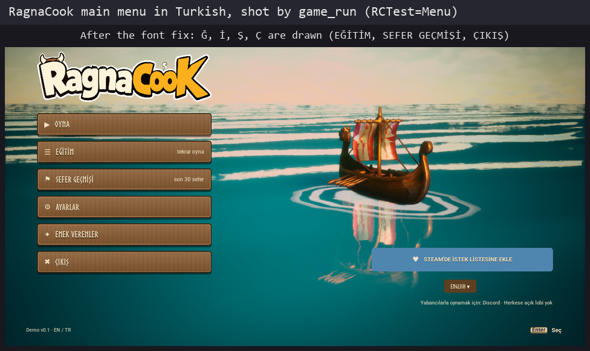
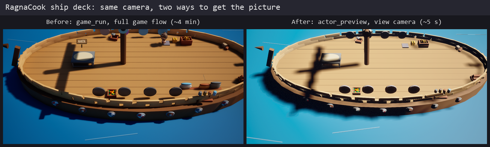
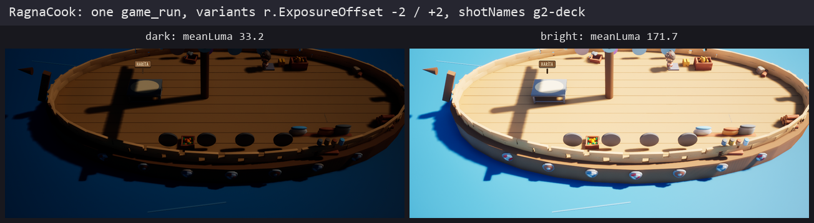

# Case study: building RagnaCook with Enginewright

RagnaCook is my co-op cooking roguelite, made in Unreal Engine 5.8 ([Steam page](https://store.steampowered.com/app/3834380/)).
I also maintain Enginewright, and the game is where the plugin gets tested for real: C++ and Blueprints, CommonUI,
Enhanced Input, a Turkish and an English version, about 600 assets. Most of the game's development and testing is done
by AI agents that talk to the editor through Enginewright.

This page shows how the game drives the tool. It doesn't describe the game's design or unreleased content.

## The rule: a workaround is a request

I want every development and test job on RagnaCook to be doable through Enginewright. So when the game's agent has to
fall back to a throwaway script, a manual click in the editor, or a slow detour, it doesn't hide the workaround.
It logs an engine request (ER-xx): which tool was missing, what input it had, what it expected, and which task was
blocked. Then:

1. RagnaCook keeps working and collects requests.
2. In an update window, Enginewright gets the tools, tested on its own test projects (never inside the game).
3. RagnaCook goes back to the blocked tasks with the new tools and marks each request "done" or "not yet".
4. A leftover check: the game's repo may only show the task's own files. No test assets, no config changes.
5. Only then a release.

The game and the plugin take turns. I don't develop both at the same time.

So far RagnaCook has logged 29 requests. 27 shipped by 0.4.0. The last two (ER-28, ER-29: FBX LODs and collision,
animation retargeting) are planned for 0.4.1. Here are four of them.

## 1. Running the game without breaking it (ER-02, ER-04, ER-05)

**Problem.** To take UI screenshots and run the game's self-tests, the agent wrote its own batch and Python scripts:
start the game in `-game` mode with a map URL, filter the log, collect the PNG files. They broke in ways that hurt. One
script cut the `=` out of the URL, so the real game started instead of the test, and my real save files were migrated
and synced to the cloud. A build started from the agent's shell died when the agent's tool hit its 420-second limit.
The next build was a full rebuild.

**Tool.** `game_run` (with `game_run_status` for long runs) passes the URL unchanged and checks it against the game's
own log. `require` stops the game within a set time if the test mode never starts, so a bad URL can't reach real
saves. One run per resolution, a verdict from log patterns, only the log lines you ask for, and the new PNG files with
their real size. The build in `ewtool.py` runs UnrealBuildTool outside the caller's process tree, so it keeps going
when the caller dies.

**In the game.** `FlowUIRunBuild` passed at 1920x1080 and 1280x800 with 13 screenshots each, URL confirmed. The `Logic`,
`FlowSave` and `FlowContinue` self-tests passed without touching real save files. The build now survives a killed
caller and finishes (`build` suite 15/15).

## 2. Turkish letters that drew as empty boxes (ER-12, ER-13)

**Problem.** The Turkish main menu showed empty boxes for Ğ, İ and Ş: the menu font has no such letters. Every
self-test passed. I caught it by eye, and by a `LogSlate: Could not find Glyph Index` warning in the log. On top of
that, `loc_culture` changed the editor's language, but `game_run` starts a separate process that didn't get it.

**Tool.** `font_coverage {font, culture}` lists the characters of a language that a Font asset or a `.ttf` / `.otf`
can't draw. `game_run` takes a `culture` and counts the characters Slate couldn't draw in the running game
(`glyphMisses`, with the first code points).

**In the game.** `font_coverage` on the menu font (Skranji-Regular) reports Ğ İ Ş ğ ş missing for `tr`. The game now
falls back to a second font for those letters, and a `game_run` with `culture: tr` on the main menu reports
`glyphMisses: 0`. A font change that brings the boxes back now fails a run instead of waiting for someone to look.

*After: the Turkish menu shot by `game_run`. I didn't keep a screenshot of the empty boxes from before the fix.*

## 3. Previewing a scene that is built in code (ER-15, ER-17)

**Problem.** The ship deck is set up in C++ at BeginPlay: railing planks, shields, crates. In the editor the class is
empty, so every set-dressing try meant a full `game_run` through the game's flow: about four minutes per look. The railing itself (two rows of 33 planks on an ellipse) came
from a Python generator the agent wrote.

**Tool.** `actor_preview` builds an actor class the way the game does (construction, BeginPlay, a few ticks), takes a
PNG from the actor's own game camera (`view: camera`), and cleans up. No Play In Editor. `scene_dress` places meshes in
a ring, ellipse, line, grid or scatter in one undo step and can write the placements into the game's DataTable.

**In the game.** `actor_preview` of `RC_ShipDeck` returns the same framing as the `game_run` shot in about 5 seconds
instead of about 4 minutes. `scene_dress` rebuilt the 66-plank railing and matched the game's `DT_SceneDressing`
rows within 0.05 cm and 0.005°, same meshes and scale, with no leftovers.

*Before: the picture came from a full game run (260 s in this run). After: `actor_preview` with the deck's own camera.
The game's HUD is cropped off the left image.*

## 4. Tuning exposure by numbers (ER-19, ER-20)

**Problem.** To match a target look, the agent set post-process exposure blind: spawn a PostProcessVolume, change a
value, run the whole game, measure the screenshot's brightness with its own Pillow script. Three tries (-0.8 too dark,
-0.4 dark, -0.15 close), each a full run of 3 to 4 minutes. The run also went through the game's entire UI flow
(13 screenshots) when only one shot mattered.

**Tool.** `game_run` takes `cvars` and `variants` (the same run once per look) and `shotNames` (stop when the named
screenshots exist). `image_stats` reports mean brightness, a luma histogram, saturation, clipped black and white, and
the difference to a reference image.

**In the game.** One call with two variants, `r.ExposureOffset -2` and `+2`, stopped at the `g2-deck` shot: 242 s and
163 s, mean luma 33.2 and 171.7, difference 138.5, with the numbers in the reply. The agent didn't need its own script.

*Both variants of the same shot, from one call. HUD cropped off.*

## The other requests

| ER | What RagnaCook needed | Now |
|---|---|---|
| ER-01 | The plugin broke the game's unity build | Builds clean with the plugin on |
| ER-03 | Side-by-side image of web mockup vs game | `image_compose` |
| ER-06 | Render a C++ `UUserWidget` class, not only Widget Blueprints | `widget_render` takes a class |
| ER-07 | `game_run` started old code after a Live Coding patch | Refused with `LIVE_CODING_PATCHED` |
| ER-08 | The game ran slowly while the editor showed a heavy map | `heavy` warning, editor viewports paused |
| ER-09 | Screenshot runs had no end signal | `shotsExpected`, `SHOTS_DONE` |
| ER-10, ER-11 | Compare `.po` / `.locres` translations, run gather/compile with the editor open | `stringtable_compare`, `loc_gather` |
| ER-14 | Delete refused without saying why | `asset_delete` gives a reason per asset |
| ER-16 | Mesh pivot and bounds | `mesh_info` bounds and pivot offsets |
| ER-18 | Defaults of inherited Blueprint components, import scale | `blueprint_set_component_defaults`, `asset_import` scale |
| ER-21 | "Press any key" tutorial panel could not be advanced | `ui_key` |
| ER-22 | Walk the player to a station | `pie_walk_to` |
| ER-23 | Buttons of closed pages were listed | `ui_state` shows only what the player can use |
| ER-24 | Set a profile flag for a test (save with a game checksum) | `savegame_get` / `savegame_set` |
| ER-25 | Icon-only buttons (⚙, ▶) could not be found by label | `ui_state` labels, `ui_click` by text or tooltip |
| ER-26 | Travel to a map with `?game=` options | `pie_travel` |
| ER-27 | Which key is bound to which action, and does the on-screen hint match | `input_map_list`, `ui_prompts` |

Before 0.4.0 I also ran every tool in the README on RagnaCook (330 calls, 11 fixes). See
[RELIABILITY_0.4.md](RELIABILITY_0.4.md).

## Your project

If your agent works around a missing tool in your own Unreal project, I'd like to hear about it: it's the same kind of
request. Paste the prompt from [REQUEST_WITH_AI.md](REQUEST_WITH_AI.md) into your agent, or open a
[Tool request](https://github.com/shanyup/enginewright/issues/new?template=feature_request.yml).
